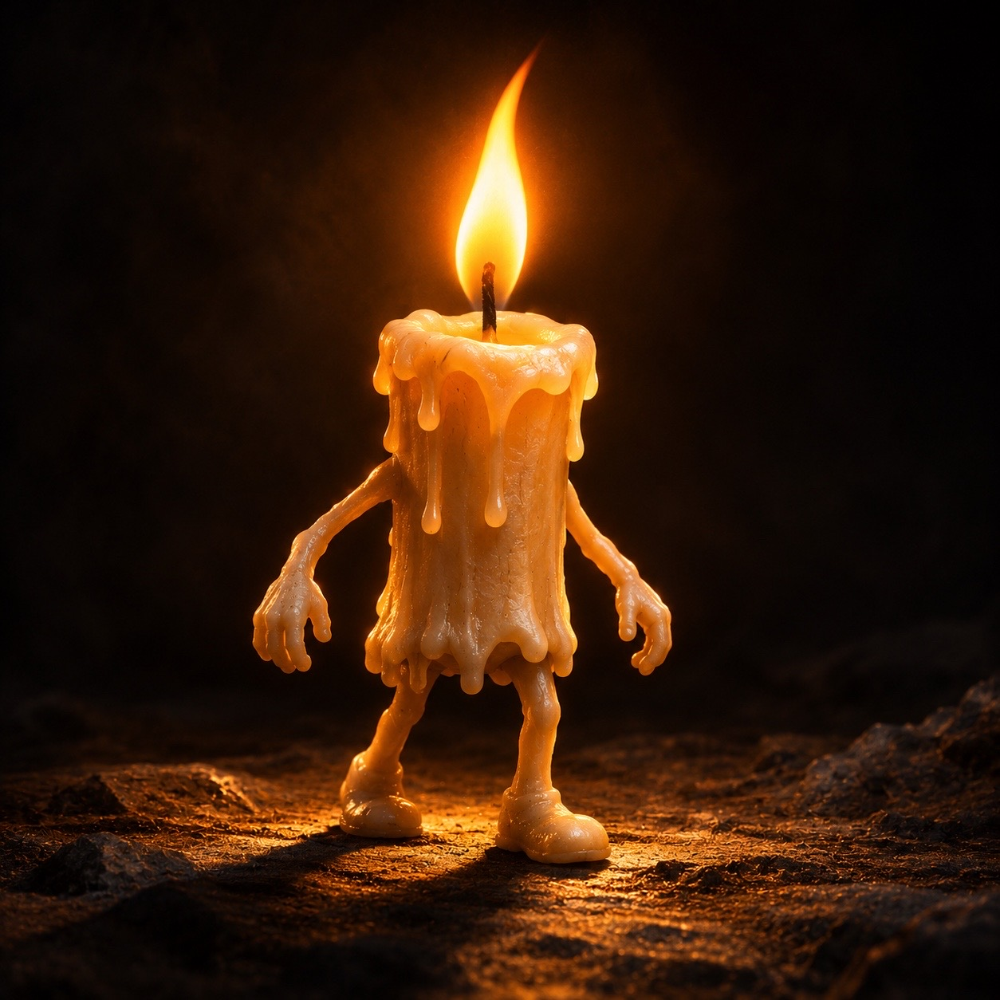

# رجل الشمعة — Candle Man

لعبة منصات جانبية ثنائية الأبعاد تعمل في المتصفح. رجل شمعة صغير يحمل شعلته عبر عالم ميت ومظلم حتى يصل إلى المشعل الكبير، فيعود النور والحياة إلى المكان.



## التشغيل

لا تحتاج اللعبة إلى أي تثبيت أو بناء. افتح `index.html` في المتصفح مباشرة، أو شغّل خادماً محلياً:

```bash
python3 -m http.server 8000
# ثم افتح http://localhost:8000
```

## التحكم

| المفتاح | الوظيفة |
|---|---|
| ← → أو A / D | الحركة |
| المسافة (أو ↑ / W) | القفز (اضغط مطولاً لقفزة أعلى) |
| E أو Shift | تقوية الضوء (3 ثوانٍ، تكلّف 12 من قوة الشعلة) |
| Esc / P | إيقاف مؤقت |
| M | كتم الصوت |

**على الآيباد والأجهزة اللمسية** تظهر أزرار على الشاشة: ◀ ▶ للحركة (يساراً)، و ⤒ للقفز و ☀ لتقوية الضوء (يميناً)، و ❚❚ للإيقاف المؤقت. يمكن الضغط على أكثر من زر في الوقت نفسه (مثلاً: الجري والقفز). اللعبة تُلعب والجهاز أفقي.

**النسخة المنشورة:** https://soufiank12-ui.github.io/my-project/

## محتوى النسخة الأولى

- **المرحلة 1: الغابة الميتة**، قابلة للعب من البداية إلى النهاية، مع تلميحات تعليمية داخل المرحلة.
- **نظام إضاءة**: الشاشة مظلمة، وحول البطل دائرة ضوء برتقالية تتغير مع قوة الشعلة. الصخور وجذوع الأشجار تُلقي ظلالاً، وذرات الغبار والشرر تطفو في الضوء.
- **مؤشر قوة الشعلة** (0–100). إذا وصل إلى صفر، أو سقط البطل في حفرة، تنطفئ الشعلة ويعود البطل إلى آخر نقطة حفظ.
- **الريح**: هبّات دورية تدفع البطل للخلف وتُضعف شعلته. تسبقها إشارة تحذير (خطوط وأوراق متطايرة وصوت). الاختباء خلف الصخور يحمي منها.
- **قطرات الماء**: تتكوّن وتلمع تحت الجذوع الساقطة ثم تسقط بإيقاع منتظم، وتُنقص الشعلة 30.
- **شرارات طائرة** تعيد 20 من قوة الشعلة.
- **شمعتا حفظ**: تشتعلان عند لمسهما، وتعيدان شحن الشعلة.
- **مشهد النهاية**: يرفع البطل يده فيشتعل المشعل الكبير، وينتشر الضوء الذهبي على الشاشة، فتتحول الألوان وتنبت الأعشاب والزهور وأوراق الأشجار، وتظهر اليراعات والطيور.
- **أصوات إجرائية** (Web Audio): همهمة الظلام، الريح، طقطقة الشعلة، القطرات، الإشعال، ولحن عودة الحياة.

## البنية

```
index.html      القوائم والواجهة (RTL)
style.css
src/util.js     أدوات رياضية وألوان
src/audio.js    مولّد الأصوات
src/draw.js     رسم الشخصية والشعلة والأشجار والصخور… (كله إجرائي، بلا صور)
src/level.js    بيانات المرحلة الأولى
src/game.js     الحلقة الرئيسية: الفيزياء، العقبات، الإضاءة، مشهد النهاية، الواجهة
```

مكتوبة بـ JavaScript و Canvas 2D فقط، دون مكتبات خارجية.

## الخطوات القادمة

- المرحلة 2 (الكهف): برك الماء، وظلام أكثف.
- المرحلة 3 (المدينة المهجورة): مخلوقات الظلام، وألغاز المصابيح والمرايا.
- قدرة سيلان الشمع (ترك قطعة شمع لسد ثقب أو صنع درجة).
